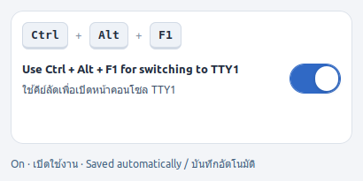

# TTY Shortcut Control

A compact GTK app to enable or disable **Ctrl + Alt + F1** switching to TTY1, with English and Thai labels and automatic saving.

แอปขนาดเล็กสำหรับเปิด–ปิดการสลับไปหน้าคอนโซล **TTY1** ด้วย **Ctrl + Alt + F1** มีภาษาไทยและอังกฤษ พร้อมบันทึกค่าอัตโนมัติ



## Features / คุณสมบัติ

- One toggle: **On** allows switching to TTY1; **Off** disables the shortcut.
- Changes take effect immediately, with no Save button.
- When disabled, a per-user autostart entry reapplies the setting after login.
- Turning it on restores this machine's original F1 mapping and removes the autostart entry.
- สวิตช์เดียว เปิด–ปิดได้ทันที ไม่ต้องกดบันทึก และจำการปิดไว้หลังล็อกอินครั้งถัดไป

## Requirements / สิ่งที่ต้องมี

- Linux with an **X11** desktop session. Wayland is not supported.
- Python 3, PyGObject, GTK 3 and `xmodmap`.
- Built and checked on **LMDE 7 (Linux Mint Debian Edition)**.

**Compatibility:** This app uses keycode **67** for F1 and a fixed original mapping from the development machine. Check that your keyboard uses the same mapping before using it on another machine:

```bash
xmodmap -pke | grep -E '^keycode +67 '
```

แอปนี้ออกแบบสำหรับ X11 และใช้รหัสปุ่ม F1 ของเครื่องต้นฉบับ หากนำไปใช้เครื่องอื่น ควรตรวจสอบรหัสและการจับคู่ปุ่มก่อน

## Install and run / ติดตั้งและเปิดแอป

On Linux Mint / Debian, install the dependencies:

```bash
sudo apt install python3 python3-gi gir1.2-gtk-3.0 x11-xserver-utils git
```

Download and open the app:

```bash
git clone https://github.com/Golffee79/tty-shortcut-control.git
cd tty-shortcut-control
/usr/bin/python3 tty-shortcut-control.py
```

Keep the project at the same path while automatic disabling is enabled. The autostart entry points to the script's location.

หากปิดคีย์ลัดไว้ อย่าย้ายหรือลบโฟลเดอร์โปรเจกต์ เพราะระบบจะเรียกสคริปต์จากตำแหน่งนี้เมื่อล็อกอิน

## Usage / วิธีใช้

| Toggle / สวิตช์ | Behavior / การทำงาน |
| --- | --- |
| **On / เปิดใช้งาน** | Ctrl + Alt + F1 switches to TTY1 / ใช้คีย์ลัดสลับไปหน้าคอนโซลได้ |
| **Off / ปิดใช้งาน** | Stops this shortcut from switching to TTY1 / ปิดการสลับหน้าจอด้วยคีย์ลัดนี้ |

Changes apply to the current user's X11 session. Other TTY shortcuts are not changed. The normal F1 key remains available.

การตั้งค่ามีผลกับเซสชัน X11 ของผู้ใช้ปัจจุบัน ปุ่ม F1 ปกติยังใช้ได้ และไม่เปลี่ยนคีย์ลัด TTY ปุ่มอื่น

## Restore or remove / คืนค่าและลบแอป

First open the app and turn the toggle **On**. This restores the shortcut and removes:

```text
~/.config/autostart/tty-shortcut-control.desktop
```

You can then remove the project folder. If you cannot open the app, restore the original mapping used by this project manually:

```bash
rm -f ~/.config/autostart/tty-shortcut-control.desktop
xmodmap -e "keycode 67 = F1 F1 F1 F1 F1 F1 XF86Switch_VT_1 F1 F1 XF86Switch_VT_1"
```

ก่อนลบแอป ให้เปิดสวิตช์ **On** เพื่อคืนค่าคีย์ลัดและนำรายการเริ่มอัตโนมัติออกก่อน
